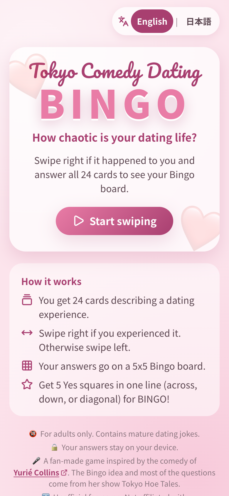
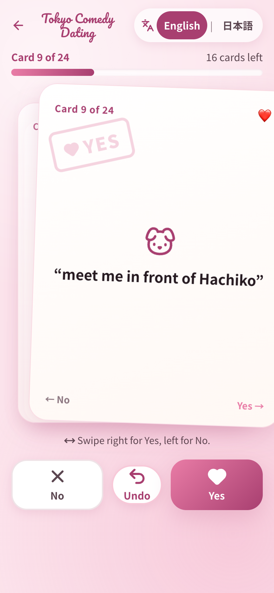
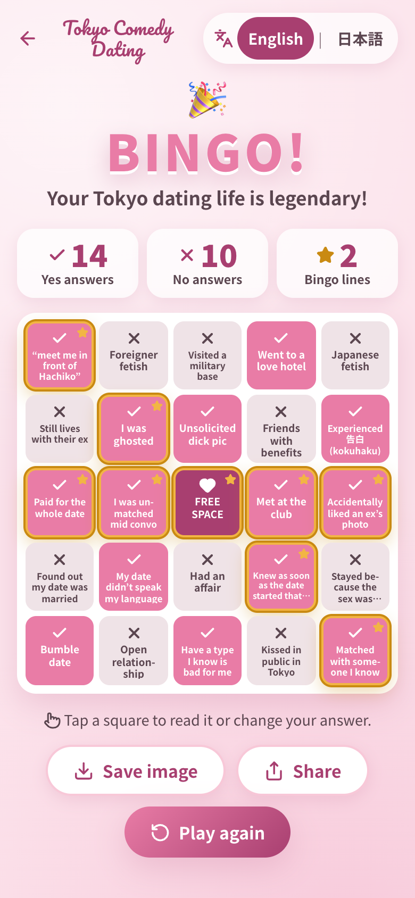
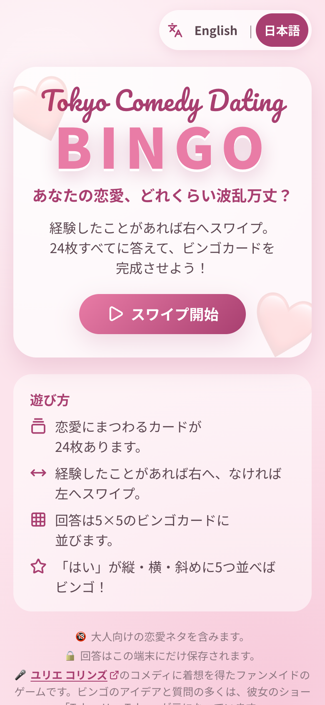
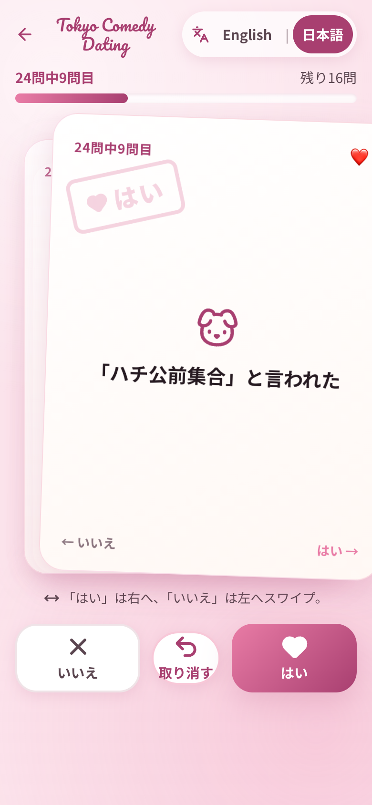
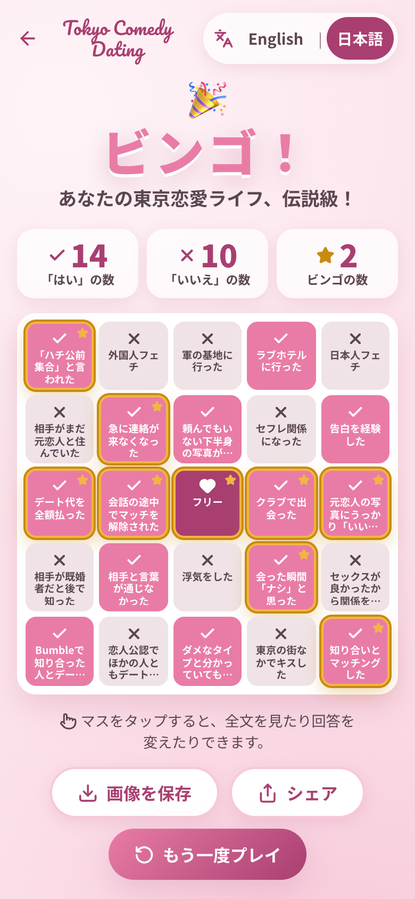

# Tokyo Comedy Dating Bingo

**Play now: [ahandsel.github.io/tokyo-comedy-dating-bingo](https://ahandsel.github.io/tokyo-comedy-dating-bingo/)**

Tinder-style swiping meets a classic 5x5 Bingo card.
Swipe through 24 Tokyo dating experiences, then reveal a randomized Bingo board built from your answers.
The game runs in the browser on a phone or a computer, in English or Japanese, and your answers never leave your device.

| Start                                                         | Swipe                                                                                  | Get your Bingo board                                                         |
| ------------------------------------------------------------- | -------------------------------------------------------------------------------------- | ---------------------------------------------------------------------------- |
|   |  |  |
|  |                            |               |

The top row shows the game in English, and the bottom row shows it in Japanese.

* Stack: Vue 3, TypeScript, Vite, Vue I18n, Vitest, pnpm, GitHub Actions, and GitHub Pages, deployed as a fully client-side static site.
* Contains mature, dating-related humour.
  Intended for adults.
* Unofficial and fan-made, inspired by the comedy of Yurié Collins.
  See [Credits](#credits).


## Credits

Tokyo Comedy Dating Bingo is a fan-made game inspired by the comedy of [Yurié Collins (ユリエ コリンズ)](https://linktr.ee/babypinkhaus).
The Bingo idea and the original 24 questions come from her show Tokyo Hoe Tales at Tokyo Comedy Bar.

* This is an unofficial fan project.
  It is not affiliated with [Tokyo Comedy Bar](https://www.tokyocomedybar.com/).
* The MIT License in `LICENSE` covers the code only.
  The Bingo idea and the original 24 questions (`q01` to `q24` in `src/data/questions.ts`) belong to Yurié Collins, so do not reuse them without her permission.
* Questions `q25` to `q29` are fan additions written for this game.
  They do not come from her show.
  `q28` and `q29` give Tokyo Comedy Bar and her live shows a shoutout on a swipe card.
* The welcome screen and the share text credit her in both English and Japanese.
  Keep these credits when you change the copy.
* The results screen gives her live shows and the stand-up shows at Tokyo Comedy Bar in Shibuya a shoutout, in both languages.
  Both names link out through `CreditLink.vue`, which holds the two URLs.


## Contents

* [Credits](#credits)
* [Contents](#contents)
* [Game rules](#game-rules)
* [English and Japanese support](#english-and-japanese-support)
* [Game-state persistence and privacy](#game-state-persistence-and-privacy)
* [Technology stack](#technology-stack)
* [Open-source research findings](#open-source-research-findings)
  * [Swiping](#swiping)
  * [Bingo](#bingo)
  * [Deployment references](#deployment-references)
* [Dependencies and licenses](#dependencies-and-licenses)
* [Local development](#local-development)
* [Testing](#testing)
* [Production builds](#production-builds)
* [GitHub Pages deployment](#github-pages-deployment)
* [Custom domain setup](#custom-domain-setup)
* [Project structure](#project-structure)
* [Updating questions](#updating-questions)
* [Editing translations](#editing-translations)
* [Adding a third language](#adding-a-third-language)
* [Theme customization](#theme-customization)
* [How the code works](#how-the-code-works)
* [Known limitations](#known-limitations)


## Game rules

1. Press "Start swiping".
   24 question IDs are drawn at random from the question pool, shuffled once with Fisher-Yates, and the order is saved.
   The pool holds more than 24 questions, so each game leaves a few cards out.
2. Each card shows one dating experience.
   Swipe right (or flick right, press the Yes button, or press the right arrow key) if you have experienced it.
   Swipe left (No button, left arrow key) if you have not.
3. "Undo" (or the down arrow key, Backspace, or Ctrl/Cmd+Z) reopens the previous card and removes its answer.
   The keys work anywhere on the swipe screen; nothing needs focus first.
4. After the 24th answer, a 5x5 board is generated: the same 24 questions are shuffled again, independently of your answers and of the swipe order, and placed around a free centre square (row 2, column 2, flat index 12, zero-based).
5. A square is marked when its answer is YES or it is the free centre.
   Any complete row, column, or diagonal (12 possible lines) is a Bingo.
   Multiple lines are counted and overlapping cells are deduplicated.
6. On the results screen you can tap any square to see the full question, your answer, and whether it is on a winning line, and you can change the answer.
   Statistics and winning lines recalculate; the board arrangement never changes.
7. "Play again" asks for confirmation, then clears the game.
   The confirmation opens with focus on "Cancel", so pressing Enter twice does not clear the game by accident.
   Your language preference is kept.

The free centre is not counted in the YES total.


## English and Japanese support

Both languages ship in the first release and are equally complete.

* **Switcher.**
  `English | 日本語` appears on the welcome, swipe, and results screens.
  Switching updates the interface, the current card, buttons, progress text, board labels, results, statistics, dialogs, status announcements, and export text immediately.
* **Switching never restarts the game.**
  Answers are keyed by stable question IDs (`q01`, `q02`, and so on), never by translated text.
  The question order and the final board arrangement are stored as ID lists, so switching language only changes what is displayed.
* **Detection on first visit.**
  A saved preference in LocalStorage wins.
  Otherwise `navigator.languages` (falling back to `navigator.language`) is scanned: the first tag starting with `ja` selects Japanese, the first tag starting with `en` selects English, and anything else falls back to English.
* **Persistence.**
  The preference is saved under the key `tcdb:preferences` only when you pick a language with the switcher; a merely detected locale is not saved.
  It is stored separately from game state, so restarting a game does not reset the language.
* **Document metadata.**
  `document.documentElement.lang` and `document.title` follow the selected language.
  Accessible labels and live-region announcements are localized.
* **Typography.**
  The body font stack is `Noto Sans JP` (loaded from Google Fonts) followed by Hiragino Sans, Yu Gothic, Meiryo, and the system UI font, so Japanese renders correctly even when the web font is unavailable.
  The script title uses Pacifico with a cursive fallback and is only used for the Latin brand name.
  Japanese text uses `line-break: strict` and `overflow-wrap: anywhere` so long labels wrap inside cards and board cells.
* **Export.**
  The PNG is drawn on a canvas with the same CJK-capable font stack after `document.fonts` has loaded, and the canvas `lang` attribute is set so glyph selection is correct.


## Game-state persistence and privacy

Game state is saved automatically on every change to LocalStorage under `tcdb:game`:

```ts
interface GameState {
  version: number;
  phase: 'welcome' | 'playing' | 'results';
  questionOrder: string[];
  currentQuestionIndex: number;
  answers: Record<string, 'yes' | 'no'>;
  answerHistory: string[];
  boardQuestionIds: (string | 'free')[] | null;
}
```

Loading validates the shape strictly (version, phase, 24 unique question IDs from the pool, valid answers, consistent undo history, a valid 25-cell board with the free centre that holds exactly the dealt cards, and phase-specific consistency such as "a board requires all 24 answers").
Anything else is discarded, a fresh game begins, and the welcome screen says so.
If LocalStorage is unavailable the game still runs in memory and the welcome screen warns that progress will not survive a refresh.

The welcome screen offers "Continue game" for a paused game and "View my board" for a finished one.
When either exists, the start button reads "New game" and asks for confirmation before discarding it.

Privacy: everything runs in the browser.
No backend, database, analytics, API keys, or remote logging.
Answers are never placed in URLs.
Sharing happens only when you press "Share" or "Save image", and the image is generated locally.


## Technology stack

| Area         | Choice                                                                                              |
| ------------ | --------------------------------------------------------------------------------------------------- |
| Framework    | Vue 3.5 (Composition API, `<script setup>`)                                                         |
| Language     | TypeScript 6 (strict, via `@vue/tsconfig`)                                                          |
| Build        | Vite 8                                                                                              |
| i18n         | Vue I18n 11 (`legacy: false`, English fallback)                                                     |
| State        | Vue composables (`useGame`, `useGameStorage`, `useLocale`); Pinia was not needed for a single store |
| Styling      | Plain CSS with custom properties                                                                    |
| Icons        | Lucide (`@lucide/vue`), imported one icon at a time                                                 |
| Swiping      | Custom Pointer Events implementation in `SwipeCard.vue`                                             |
| Bingo engine | Custom pure TypeScript (`utils/board.ts`, `utils/bingo.ts`)                                         |
| Export       | Native Canvas 2D API, Web Share API with download fallback                                          |
| Celebration  | `canvas-confetti` (lazy-loaded)                                                                     |
| Tests        | Vitest 5 with jsdom and Vue Test Utils                                                              |
| CI/CD        | GitHub Actions with `pnpm/action-setup`, GitHub Pages                                               |


## Open-source research findings

Candidates were reviewed for Vue 3 compatibility, TypeScript support, gesture support, undo, keyboard access, maintenance, dependency weight, and license before implementation.


### Swiping

| Project                                                         | License | Findings                                                                                                                                                            | Decision                                                                                                                                                                                                                                      |
| --------------------------------------------------------------- | ------- | ------------------------------------------------------------------------------------------------------------------------------------------------------------------- | --------------------------------------------------------------------------------------------------------------------------------------------------------------------------------------------------------------------------------------------- |
| [vue3-flashcards](https://github.com/vad1ym/vue3-flashcards)    | MIT     | Vue 3, typed, touch and mouse, left/right events, undo ("restore"), zero dependencies. No keyboard or accessibility support documented. Small community (15 stars). | Rejected. Closest fit, but adding a dependency to save roughly 150 lines of pointer code was not worth losing control over keyboard handling, ARIA labels, reduced-motion behaviour, and the leaving-card animation that keeps undo coherent. |
| [tallman-swiper](https://github.com/tallmancode/tallman-swiper) | MIT     | Vue 3 and TypeScript with keyboard and ARIA support, but it is a full application (Express server, Sentry, Pexels API key), not a reusable package.                 | Rejected: not consumable as a component.                                                                                                                                                                                                      |
| [vue-tinder](https://github.com/shanlh/vue-tinder)              | MIT     | Vue 2 only, no TypeScript.                                                                                                                                          | Rejected: incompatible with Vue 3.                                                                                                                                                                                                            |
| [VueUse](https://vueuse.org/) `usePointerSwipe`                 | MIT     | Vue 3, typed, mouse/touch/pen, direction and threshold detection, 1.3 kB. No rotation, overlays, or undo (those are UI concerns anyway).                            | Not adopted. It would only replace the pointer bookkeeping; the card transform, stamps, and threshold logic still had to be written. A custom implementation keeps the app dependency-free here.                                              |

Implemented: `SwipeCard.vue` uses Pointer Events with pointer capture and `touch-action: none`, a threshold of `min(120px, 35% of card width)`, a flick rule (40px at 0.5px/ms) for quick thumb swipes, rotation proportional to drag distance, YES/NO stamps whose opacity follows progress, snap-back below the threshold, and a leaving-card exit transition that starts from wherever the finger let go.
`SwipeDeck.vue` stacks the next two cards, keeps leaving cards under their original keys so the exit animates, and ignores repeated events for a card that is already leaving.
`GameView.vue` owns the page-wide keyboard controls.
See [docs/swiping.md](docs/swiping.md).


### Bingo

| Project                                                   | License | Findings                                                                                                                                         | Decision                                                                                              |
| --------------------------------------------------------- | ------- | ------------------------------------------------------------------------------------------------------------------------------------------------ | ----------------------------------------------------------------------------------------------------- |
| [mengxiaozhi/Bingo](https://github.com/mengxiaozhi/Bingo) | MIT     | Vue 3 + Vite generator app (Naive UI, Tailwind), JavaScript only, no exported engine.                                                            | Rejected: an app, not a library, and untyped.                                                         |
| [bingo-ts](https://github.com/ya-s-u/bingo-ts)            | MIT     | Clean TypeScript, 5x5 board with free centre, row/column/diagonal judging. Cells are numbers 1 to 75 in B-I-N-G-O ranges; no custom text labels. | Rejected: number-based model would need adapting and gives no advantage over a 60-line custom engine. |
| [lucasnetau/bingo](https://github.com/lucasnetau/bingo)   | MIT     | Plain HTML 75-ball bingo with manual win claiming.                                                                                               | Rejected: no engine to reuse.                                                                         |

Implemented: `utils/board.ts` (Fisher-Yates arrangement with FREE at index 12, validation) and `utils/bingo.ts` (12 precomputed lines, marked-cell evaluation returning `BingoResult` with deduplicated winning cell indices).
The engine never sees translated text.


### Deployment references

* [pnpm/action-setup](https://github.com/pnpm/action-setup) reads the pnpm version from the `packageManager` field when `version` is omitted.
* [Vite static deploy guide](https://vite.dev/guide/static-deploy) provided the Pages workflow shape (`configure-pages`, `upload-pages-artifact`, `deploy-pages`) and the `base` setting for project sites.


## Dependencies and licenses

Runtime:

| Package           | License | Purpose                                                                |
| ----------------- | ------- | ---------------------------------------------------------------------- |
| `vue`             | MIT     | UI framework                                                           |
| `vue-i18n`        | MIT     | Localization                                                           |
| `canvas-confetti` | ISC     | Confetti on Bingo (lazy-loaded, decorative only)                       |
| `@lucide/vue`     | ISC     | Interface icons, bundled at build time, so they add no network request |

Development: `vite`, `@vitejs/plugin-vue`, `vue-tsc`, `typescript` (Apache-2.0), `@vue/tsconfig`, `vitest`, `@vue/test-utils`, `jsdom`, `@types/node`, `@types/canvas-confetti` (all MIT unless noted).

Icon data: the ring on the `q11` swipe card and the bee on the `q20` swipe card are copied from [Lucide Lab](https://github.com/lucide-icons/lucide-lab) under the ISC License, because `@lucide/vue` does not include them.

Fonts: Noto Sans JP and Pacifico are loaded from Google Fonts under the SIL Open Font License.
If the fonts fail to load, system fallbacks are used.

The code is released under the MIT License (see `LICENSE`).
The license does not cover the Bingo idea or the question content, which belong to Yurié Collins.
See [Credits](#credits).


## Local development

Requirements:

* Node.js 24 LTS (`.node-version` pins 24.22.2 for nodenv, fnm, asdf, and GitHub Actions)
* pnpm 12 (`packageManager` in `package.json` pins 12.16.1; any pnpm 10 or newer on the PATH downloads and runs the pinned version automatically)

```sh
pnpm install
pnpm dev       # start the dev server
pnpm test      # run the Vitest suite once
pnpm typecheck # vue-tsc project build (no emit)
pnpm build     # production build into dist/
pnpm preview   # serve the production build locally
pnpm lint      # format with Prettier, then fix Markdown with markdownlint-cli2
pnpm check     # lint, test, then build; run it before every commit
pnpm index     # list every pnpm script defined in package.json
```

`pnpm test:watch` runs Vitest in watch mode.
pnpm is the only supported package manager; do not commit `package-lock.json` or `yarn.lock`.

Formatting rules live in `.prettierrc.json5` and `.markdownlint-cli2.jsonc`, imported from [ahandsel.github.io](https://github.com/ahandsel/ahandsel.github.io).
`src/` is excluded in `.prettierignore` because `prettier-plugin-autocorrect` would only re-space the Japanese UI copy there.


## Testing

`pnpm test` runs 127 tests across ten files in `src/tests/`:

* `questions.test.ts`: the 29-question pool, unique IDs, both translations present, corrected labels, the fan-made cards in both languages, 告白 rendering.
* `i18n.test.ts`: browser-language detection, saved preference precedence, corrupted preferences, key parity between `en` and `ja`, English fallback, progress formatting, the switcher, full-app language switching on the welcome, swipe, and results screens (IDs, answers, order, and board preserved; preference preserved across restart and reload), the credits on the welcome screen and in the share text, and the shoutout on the results screen.
* `swipe.test.ts`: pointer gestures (left, right, snap-back, visual feedback, non-interactive cards), store answers, dealing 24 different cards, undo, re-answering, 24-answer completion, button/keyboard/gesture equivalence, double-event protection, the preserved card element during the exit animation, undo while a card is leaving, a new answer right after an undo, and the flick rules.
* `keyboard.test.ts`: page-wide arrow keys and undo shortcuts, key repeat, modifier keys, listener cleanup, and arrow-key navigation inside the Bingo grid.
* `dialogs.test.ts`: the native dialog wrapper, the initial focus on "Cancel" and "Close", the start-over confirmation on the welcome screen, and the corrupted-data notice.
* `icons.test.ts`: Lucide icons stay hidden from screen readers and add no text to button labels on every screen and in the cell dialog, each board square shows the check, cross, or heart icon that matches its state, each status message and the restart confirmation show their icon, each link that opens a new tab shows the external-link icon, and only the Hachiko swipe card shows the dog icon above its text.
* `board.test.ts`: shuffle, dealing 24 cards from the pool, 25 cells, FREE centre, all 24 dealt questions once, a board built from exactly the dealt cards, validation, independence from answers and swipe order, stable order across reload and edits.
* `bingo.test.ts`: 12 lines, horizontal, vertical, both diagonals, free centre, all NO, all YES (12 lines), multiple wins with deduplication, four-in-a-row is not Bingo, language independence.
* `storage.test.ts`: strict parsing, phase-consistency rules, boards that must hold the dealt cards, saves from before the pool grew, auto-save and reload of answers, order, index, and board, restart, corrupted storage, missing storage, answer editing without reshuffle, pause and resume, and the one-time reveal flag.
* `export.test.ts`: tokenizing and wrapping for English and Japanese, canvas drawing with all 25 cells in each language, the board and stat marks drawn as Lucide icon shapes that match the shapes `@lucide/vue` renders, Web Share fallback, saving to Photos on an iPhone.

Build and deployment checks (`pnpm typecheck`, `pnpm build`, `pnpm install --frozen-lockfile`) run in CI before every deployment.
End-to-end browser tests are not included; see Known limitations.


## Production builds

```sh
pnpm build
pnpm preview
```

`vite.config.ts` sets `base` from the `BASE_PATH` environment variable, defaulting to `/tokyo-comedy-dating-bingo/`.
The same base is used by `pnpm dev` and `pnpm preview`, so the local URL mirrors production (for example `http://localhost:5173/tokyo-comedy-dating-bingo/`).

```sh
BASE_PATH=/my-fork-name/ pnpm build # project site with a different repository name
BASE_PATH=/ pnpm build              # root site or custom domain
```

The app is a single page with no router, so refreshing on GitHub Pages never produces a 404.


## GitHub Pages deployment

`.github/workflows/deploy.yml` runs on every push to `main` and on manual dispatch.
It checks out the repository, sets up pnpm (version from `packageManager`) and Node.js (version from `.node-version`), runs `pnpm install --frozen-lockfile`, `pnpm test`, `pnpm typecheck`, and `pnpm build` with `BASE_PATH=/<repository-name>/`, then uploads `dist/` and deploys it with `actions/deploy-pages`.
Permissions are limited to `contents: read`, `pages: write`, and `id-token: write`.

One-time setup:

1. Push the repository to GitHub.
2. Open Settings, then Pages, and set Source to "GitHub Actions".
3. Push to `main` or run the workflow manually from the Actions tab.
4. The site is served at `https://<owner>.github.io/<repository-name>/`.

If you rename the repository, nothing needs to change; the workflow derives the base path from the repository name.


## Custom domain setup

1. In the workflow, change the build step's `BASE_PATH` to `/`.
2. Add a `public/CNAME` file containing your domain (for example `bingo.example.com`).
   Vite copies it into `dist/`.
3. Configure the DNS record for your domain according to GitHub's documentation, then enter the domain under Settings, then Pages, then Custom domain.


## Project structure

```text
tokyo-comedy-dating-bingo/
  .github/workflows/deploy.yml   pnpm-based build, test, and Pages deployment
  .node-version                  Node 24 LTS pin
  docs/                          how the code works, one page per layer
  docs/images/                   the screenshots at the top of this README
  public/favicon.svg
  scripts/index.sh               lists the pnpm scripts (pnpm index)
  src/
    App.vue                      phase-based view switching
    main.ts                      i18n bootstrap with saved or detected locale
    style.css                    theme tokens, typography, shared buttons
    components/
      LanguageSwitcher.vue       English | 日本語
      SwipeCard.vue              pointer gestures, flick detection, rotation, stamps, exit and return CSS
      SwipeDeck.vue              card stack, leaving list, undo animation, double-event guard
      SwipeControls.vue          No / Undo / Yes buttons
      ProgressIndicator.vue      localized "Question n of 24" and progress bar
      BingoBoard.vue             5x5 grid
      BingoCell.vue              marked, free, and winning states with accessible labels
      ResultSummary.vue          Bingo / No Bingo heading and statistics
      CellDetailModal.vue        tap-to-inspect and edit an answer
      ConfirmDialog.vue          restart confirmation
      ModalDialog.vue            accessible <dialog> wrapper
      CreditLink.vue             new-tab link to Yurié Collins or Tokyo Comedy Bar
    views/
      WelcomeView.vue            start, resume, start-over confirmation, storage notices, credits
      GameView.vue               swipe screen and page-wide keyboard controls
      ResultsView.vue            board, reveal, edit, export, share, restart, shoutout
    composables/
      useGame.ts                 reactive game store and rules
      useGameStorage.ts          LocalStorage persistence and strict validation
      useLocale.ts               locale switching, persistence, <html lang>, title
    data/questions.ts            the bilingual question pool
    i18n/
      index.ts                   createI18n, detection, preference storage
      locales/en.ts              interface messages (schema source)
      locales/ja.ts              interface messages (typed against en)
    types/game.ts, types/i18n.ts
    utils/
      shuffle.ts                 Fisher-Yates and a seeded PRNG for tests
      board.ts                   card dealing, board generation, and validation
      bingo.ts                   winning-line evaluation
      exportImage.ts             canvas PNG rendering, share, download
    tests/                       Vitest suites and helpers
  index.html
  vite.config.ts
  package.json, pnpm-lock.yaml, pnpm-workspace.yaml
  .prettierrc.json5, .prettierignore, .markdownlint-cli2.jsonc
  tsconfig*.json
```


## Updating questions

Edit `src/data/questions.ts`.
Each entry needs a stable `id` and `text` for every locale:

```ts
{ id: 'q30', text: { en: 'New experience', ja: '新しい経験' } }
```

Rules enforced by tests and by the board generator:

* At least 24 questions.
  Each game deals 24 of them at random, one for every square of the 5x5 board except the free centre.
  Changing the board size requires changing `BOARD_SIZE` logic and is not supported as-is.
* `questions.test.ts` pins the size of the pool, so update it when you add or remove a question.
* IDs must be unique.
  Keep existing IDs stable: saved games reference them, and changing an ID invalidates saved progress (the loader will safely start a new game).
* Every locale must have non-empty text.

Add a question that does not come from Tokyo Hoe Tales below the fan additions comment, and update [Credits](#credits) to match.


## Editing translations

Interface strings live in `src/i18n/locales/en.ts` and `src/i18n/locales/ja.ts`.
The English file defines the schema; the Japanese file is typed as `MessageSchema`, so `pnpm typecheck` fails if a key is missing, and `i18n.test.ts` checks key parity in both directions.
Question text is edited in `src/data/questions.ts`, not in the locale files, so each question is translated exactly once.

Messages use Vue I18n named interpolation (`{current}`, `{total}`) and pipe-separated plural forms (`game.remaining`).
Missing keys fall back to English at runtime.


## Adding a third language

1. Add the code to `Locale` and `LOCALES` in `src/types/game.ts`.
2. Add `text.<code>` to every question in `src/data/questions.ts` (TypeScript will flag missing ones).
3. Create `src/i18n/locales/<code>.ts` typed as `MessageSchema` and register it in `messages` in `src/i18n/index.ts`.
4. Extend `detectLocale` in `src/i18n/index.ts` if browser detection should select it.
5. Add an option to `LanguageSwitcher.vue`.
6. Run `pnpm typecheck` and `pnpm test`; the parity test will cover the new catalogue once it is included in `messages`.


## Theme customization

Colours, fonts, radii, and shadows are CSS custom properties at the top of `src/style.css`:

```css
--blush: #fce4ec;
--rose: #e97ca6;
--berry: #a83f70;
--cream: #fff8f4;
--ink: #261a21;
```

The exported PNG uses matching constants in `src/utils/exportImage.ts` (`COLORS`) and the same font stacks (`EXPORT_FONT_STACK`, `EXPORT_SCRIPT_STACK`).
Web fonts are declared in `index.html`.
The export also draws the check, cross, heart, and star icons from Lucide path data that it copies into `EXPORT_ICON_PATHS`, because `src/utils/` must not import Vue.
`src/tests/export.test.ts` fails when a copied path no longer matches the icon that `@lucide/vue` renders.

Interface icons come from Lucide (`@lucide/vue`).
Import each icon by name, such as `import { Heart } from '@lucide/vue'`, so the build includes only the icons in use.
The `.lucide` rule in `src/style.css` sizes every icon to the text around it, and icons take the text color.
That rule overrides the `size` and `stroke-width` props, so set a larger icon or a heavier stroke with a component class in CSS.
Mark each icon `aria-hidden="true"` and keep a visible text label or an `aria-label` on the control, so the icon never carries meaning by itself.
Use the same icon for the same meaning everywhere: `Check` and `X` for Yes and No squares, `Heart` for the Yes button and the free square, `Star` for winning lines, `Mic` for the comedy shoutout, `ExternalLink` for links that open a new tab, and `Undo2`, `RotateCcw`, `Download`, and `Share` for their actions.
Every swipe card shows artwork above its text, such as `Dog` for the Hachiko statue on the `q19` card.
`CARD_ICONS` in `src/components/SwipeCard.vue` maps each question ID to its card artwork.
The `q11` card shows a wedding ring, and the `q20` card shows a bee for the Bumble logo.
`@lucide/vue` has neither icon, so `SwipeCard.vue` copies both from [Lucide Lab](https://github.com/lucide-icons/lucide-lab) and builds them with `createLucideIcon`.
Copy any other Lucide Lab icon the same way, rather than adding the `@lucide/lab` package.
The `q25` and `q26` cards are a pair, so both use `FaceSlightlyFrowning`.
The `q28` card uses `FaceGrinning` for laughter at a comedy night.
Lucide has no other laughing face: `Laugh` is an old name for the same icon, and Lucide Lab has none either.
Card artwork must not reuse an icon that already has a meaning in this section.
Status messages use `LoaderCircle` while the image is being made, `CircleCheck` for success, `Pencil` for a changed answer, and `TriangleAlert` for errors, warnings, and confirmations.
A link that opens a new tab ends with `ExternalLink`.
The decorative heart motifs, the result emoji, and the emoji in the welcome notices stay as emoji.

Reduced motion is respected: with `prefers-reduced-motion: reduce`, animations are disabled, the reveal delay is skipped, and confetti is not shown.


## How the code works

The [docs/](docs/README.md) folder explains each layer: [architecture](docs/architecture.md), [game state and persistence](docs/game-state.md), [swiping, keyboard, and mobile](docs/swiping.md), [Bingo engine and export](docs/bingo-and-export.md), [internationalization](docs/i18n.md), and [development](docs/development.md).


## Known limitations

* No end-to-end browser tests.
  Gesture and language behaviour is covered by jsdom-based component and integration tests; real-device testing of touch gestures and PNG export is manual.
* Web fonts come from Google Fonts.
  Offline or blocked, the app falls back to system fonts, so the title loses its script style and the export may render with a different sans-serif.
* The Web Share API with files is only available on some browsers (notably mobile Safari and Chrome on Android).
  Elsewhere the Share button is hidden and "Save image" is used.
* No web API can write straight to the Photos library on an iPhone or iPad.
  "Save image" opens the share sheet there instead, and the player taps "Save Image" to add the image to Photos.
* Native `<dialog>` is required for the modal backdrop and focus trapping; very old browsers show the dialog inline.
* The board is fixed at 5x5, so each game shows 24 of the questions in the pool.
